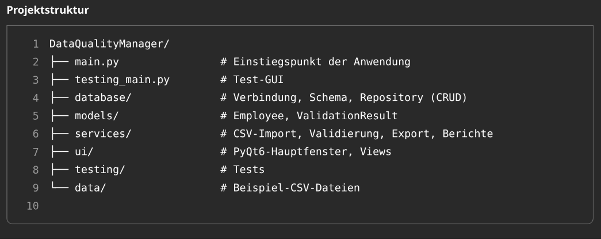
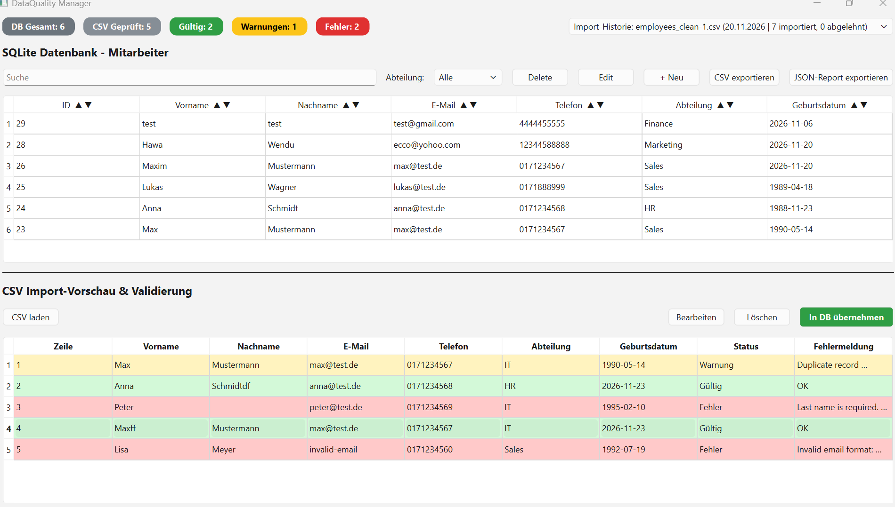

### DataQuality Manager
CSV Data Management and Quality Validation with Python

DataQuality Manager ist eine Desktop-Anwendung zur Verwaltung und Überprüfung von Mitarbeiterdaten. CSV-Dateien können eingelesen, geprüft und als Vorschau angezeigt werden. Die Anwendung soll fehlerhafte, unvollständige oder doppelte Datensätze erkennen, Mitarbeiterdaten verwalten und Ergebnisse exportieren.
Projektstatus: Diese README beschreibt den geplanten Funktionsumfang des Teamprojekts. Bitte aktualisiert die Feature-Status und die Installationshinweise, sobald die Implementierung abgeschlossen bzw. eure Dateien und Schnittstellen festgelegt sind.

## Inhaltsverzeichnis:

- Projektziel
- Funktionen
- Technologien
- Voraussetzungen
- Installation
- Anwendung starten
- CSV-Dateiformat
- Projektstruktur
- Datenqualitätsprüfung
- Mögliche Erweiterungen

## Projektziel:
Unternehmen erhalten Mitarbeiterdaten aus verschiedenen Abteilungen in CSV-Dateien. Diese Dateien können fehlende Angaben, ungültige Werte, Duplikate oder uneinheitliche Daten enthalten.

DataQuality Manager soll diese Daten in einer Desktop-Anwendung importieren, verwalten, prüfen und exportieren. Das Ziel ist eine übersichtliche und zuverlässige Datenverwaltung mit verständlichen Fehlermeldungen und Qualitätsberichten.

## Funktionen:
Der geplante Mindestumfang umfasst:
- CSV-Import: CSV-Datei auswählen, einlesen und erforderliche Spalten prüfen.
- Import-Preview: Eingelesene Datensätze vor der weiteren Verarbeitung in einer Tabelle anzeigen.
- Mitarbeiterverwaltung: Mitarbeiterdaten anzeigen, hinzufügen, bearbeiten und löschen.
- Datenqualitätsprüfung: Fehlende Pflichtwerte, ungültige E-Mail-Adressen, Duplikate, ungültige Datumsangaben und fehlerhafte Telefonnummern erkennen.
- Datenbank: Mitarbeiterdaten, Prüfergebnisse und Importhistorie in SQLite speichern.
- Suche und Filter: Datensätze nach Name oder E-Mail suchen sowie nach Abteilung oder Prüfstatus filtern.
- Export: Daten als CSV sowie Qualitätsberichte und Fehlerberichte als JSON exportieren.
- Fehlerbehandlung: Verständliche Hinweise bei fehlenden Dateien, ungültigen CSV-Dateien oder Datenbankproblemen anzeigen.

## Technologien:
- Python 3
- PyQt6 – grafische Benutzeroberfläche
- CSV – Import und Export von CSV-Dateien
- SQLite – persistente Speicherung
- JSON – Qualitätsberichte
- Git – Versionsverwaltung und Zusammenarbeit

## Voraussetzungen:
- Python 3.10 oder eine kompatible, vom Team festgelegte Python-Version
- pip
- Git

## Installation
1. Repository klonen:
  - git clone <REPOSITORY-URL>
2. In den Projektordner wechseln:
  - cd DataQualityManager
  - pip install PyQt6
  - pip install -r requirements.txt

Anwendung starten:
- Python3 main.py

## CSV datei Beispiel:
first_name  |last_name | email       | phone     | department|
----------- | ---------|------------ | ----------| ----------|  
Max         |Mustermann|max@test.de  | 0171234567|    IT     |
Anna        |Schmidt   |anna@test.de | 0171234568|    HR     | 
Peter       | ,,       |peter@test.de| 0171234569|    IT     |
Max         |Mustermann|max@test.de  | 0171234567|    IT     |
Lisa        |Meyer     |invalid-email| 0171234560|  Sales    |

Beim import sollen fehlende erfordeliche Spalten erkannt und gemeldet werden.

## Projecktstrucktur:

Dataenqualitätsprüfung:
Die genaue Behandlung von Datensätzen mit Fehlern oder Warnungen (z. B. speichern, ablehnen oder trotzdem importieren) wird vom Team festgelegt.

Application User Interface:

## Mögliche Erweiterungen:

Diese Funktionen sind optionale Erweiterungen und sollen die Kernfunktionen nicht blockieren:
- MySQL als alternative Datenbank
- Benutzeranmeldung und Passwort

